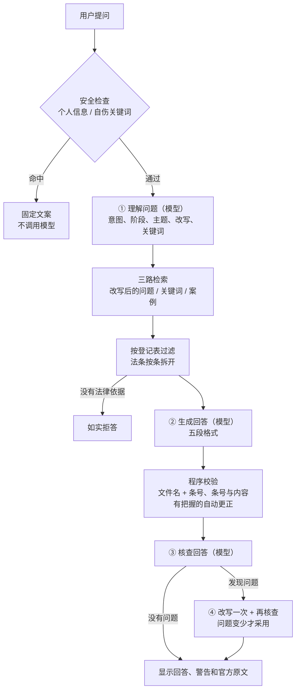

# 婚姻法律风险问答助手（中国大陆）

> A single-file RAG chatbot that answers everyday marriage-law questions under mainland China law, citing the exact statute and article and showing the official text. Built for EdUHK INT6137.

一个面向普通人的**婚姻法律普法问答助手**。它回答彩礼、夫妻共同财产、子女抚养、家暴维权这几类常见问题。每个回答都写明依据出自**哪份文件第几条**，并在下面原样展示官方原文，方便用户自己核对。

整个机器人只有一个 `index.html` 文件，运行在 INT6137 课程的 TokenProxy 平台上。

> ⚠️ **免责声明**：本工具只提供法律信息，**不是法律意见**，不能代替律师。参考案例只说明法院在类似情况下怎么判过，个案结果不代表你的情况。一切以官方文本为准。

| 项目 | 内容 |
| --- | --- |
| 课程 | 香港教育大学（EdUHK）INT6137 專題研習 I：開發專業的聊天機械人 |
| 当前版本 | **V0.9**（2026-11-06，待组内实测） |
| 资料范围 | 6 份现行法律和司法解释，另有 18 个最高人民法院典型案例（只作参考） |
| 运行方式 | 单个 HTML 文件，不用后端、不用外部库、不用构建工具 |

---

## 目录

- [它能做什么](#它能做什么)
- [怎么运行](#怎么运行)
- [一个问题是怎么被回答的](#一个问题是怎么被回答的)
- [仓库里有什么](#仓库里有什么)
- [知识库](#知识库)
- [可以改的设置](#可以改的设置)
- [更新知识库的步骤](#更新知识库的步骤)
- [测试](#测试)
- [安全、隐私与合规](#安全隐私与合规)
- [已知限制](#已知限制)
- [版本历史](#版本历史)
- [小组成员](#小组成员)
- [许可](#许可)

---

## 它能做什么

| 功能 | 说明 |
| --- | --- |
| 回答带依据 | 回答固定分五段：【结论】【法律依据】【参考案例】【风险提示】【建议下一步】，每个条号都写明出自哪份文件 |
| 原文对照 | 回答下面按“法律 / 司法解释 / 参考案例”分组，原样展示检索到的官方原文，并标出回答引用了哪几条 |
| 结论分情形 | 条文对不同情况有不同结果时，按“· 如果（条件）：（结果）（《文件》第X条）”分条写，不合并成笼统结论 |
| 引用自动核对 | 程序检查每个“《文件》第X条”是不是真在资料里，旁边那句话是不是真出自这一条；写错又有把握的直接改对，并告诉用户改了哪里 |
| 模型自查 | 另一次模型调用检查“结论和条文是否相反”“有没有替用户假设事实”等问题，发现问题就改写一次 |
| 不乱答 | 检索不到法律或司法解释依据时，不调用模型，如实说“资料中没有” |
| 安全底线 | 有自伤表达时直接给求助文案；提到家暴时在页面顶部显示 110、12338、12348；提到旧《婚姻法》时提示它已失效 |
| 隐私保护 | 问题里有身份证号、手机号时，在网页里就拦下，不发送；不保存聊天记录 |

**它不做什么**：不提供法律意见，不预测官司输赢，不代写诉状，不涉及港澳台法律，不回答资料范围以外的法律问题。

---

## 怎么运行

同一个 `index.html`，放在哪里都能用，不用改代码：

| 方式 | 怎么做 | 密钥 |
| --- | --- | --- |
| **课程平台（正式发布）** | inclass → My model key → Publish chatbot → Upload 上传 `index.html` → Publish | 网页里**没有密钥**，平台在请求发出时自动加上组别密钥 |
| **本地测试** | 直接双击 `index.html`，或用 `localhost` 打开 | 粘贴自己的 `tp-live-…` 密钥；可勾选“记住”，只保存在本机浏览器 |
| **GitHub Pages** | 仓库 Settings → Pages → 选 `main` 分支根目录，打开 `https://<用户名>.github.io/<仓库名>/` | 访客粘贴自己的密钥；这里**不提供“记住”**，关掉网页就忘记 |

> 检索用的知识库是本组在课程平台上传的资料。别人 fork 这个仓库后，要把 `kb/` 里的文件上传到自己的知识库，并按[更新知识库的步骤](#更新知识库的步骤)重新登记编号，否则会一直回答“资料中没有”。

**调试信息**：在自己电脑上打开时，答不出来会自动显示检索到了哪些资料、哪些没登记。放到平台上要看，就在网址末尾加 `#debug` 再刷新。

---

## 一个问题是怎么被回答的

打个比方：这像一位很谨慎的实习生答题。先弄清你问的是什么，再去资料柜找对应的条文，写好答案后交给“校对员”逐条核对条号，校对员挑出毛病就重写一遍。最后把答案和原始条文一起交给你。



| 步骤 | 谁来做 | 解决什么问题 |
| --- | --- | --- |
| 安全检查 | 网页程序 | 自伤、隐私这类事不能等模型判断 |
| ① 理解问题 | 模型 | 用户说“冷静期咋回事”，改写成法律说法后才搜得准；判断婚前 / 婚内 / 离婚阶段 |
| 检索与过滤 | 网页程序 | 只用登记过的现行有效资料；法条一条一块，减少模型把条号张冠李戴 |
| ② 生成回答 | 模型 | 把法言法语翻成大白话 |
| 程序校验与更正 | 网页程序 | 抓出“条号写错”“把甲文件的第五条写成乙文件的第五条”，不花模型调用 |
| ③ 核查 | 模型 | 程序查不了“意思讲反了”，交给模型查 |
| ④ 改写 | 模型 | 发现问题就真改掉，而不只是给警告 |

每个问题正常调用模型 **3 次**（理解、生成、核查），发现问题时加 2 次（改写、再核查），**最多 5 次**。默认模型是 `tokenproxy/fast`。

---

## 仓库里有什么

```text
marriage-law-chatbot/
├── index.html                  正式版问答助手（V0.9），上传到课程平台的就是它
├── kb/                         知识库：上传到课程平台知识库的文件
│   ├── minfadian-hunyin.txt    《民法典》第五编 婚姻家庭
│   ├── hunyin-jieshi-1.txt     婚姻家庭编解释（一）
│   ├── hunyin-jieshi-2.txt     婚姻家庭编解释（二）
│   ├── caili-guiding.txt       涉彩礼纠纷规定
│   ├── fanjiabao-fa.txt        《反家庭暴力法》
│   ├── baohuling-guiding.txt   人身安全保护令规定
│   ├── cases-spc.txt           最高人民法院典型案例 18 个
│   └── 资料台账.csv            每份资料的来源、读取日期、文号、SHA-256
├── tools/                      整理和检查资料的工具（不用上传到平台）
│   ├── kb-probe.html           知识库探测页：只检索不调用模型，看编号、分数、切段
│   ├── kb-formatter.html       官方原文格式化：粘贴原文 → 整理 → 核对条数 → 下载
│   ├── check_articles.py       检查法条文件的条号是否齐全、有无重复
│   └── check_cases.py          检查案例字段、官方链接、身份证号、手机号、疑似真名
├── test/                       测试用
│   ├── index-test.html         测试版（登记的是虚构资料，页面顶部有红色“测试版”横幅）
│   ├── test-*.txt              虚构的测试资料，每条都标着“测试数据，不是真实法律”
│   └── marriage-rag-testset-mainland.csv   测试题集（25 题，目标扩充到 40 题以上）
└── docs/
    └── SKILL.md                完整开发说明（给 AI 编程助手和组员看的规则、流程、模板）
```

---

## 知识库

### 资料清单

全部从官方来源取得，用 SHA-256 核对过与网页原文逐字一致，条数全部对上（见 `kb/资料台账.csv`）。

| 文件 | 资料 | 文号 | 施行日期 | 条数 / 案例数 | 来源 |
| --- | --- | --- | --- | --- | --- |
| `minfadian-hunyin.txt` | 《中华人民共和国民法典》第五编 婚姻家庭 | 主席令第四十五号 | 2021-01-01 | 第一千零四十条至第一千一百一十八条，79 条 | [最高人民法院官网转载新华网全文](https://www.court.gov.cn/zixun/xiangqing/233181.html) |
| `hunyin-jieshi-1.txt` | 最高人民法院关于适用《中华人民共和国民法典》婚姻家庭编的解释（一） | 法释〔2020〕22号 | 2021-01-01 | 91 条 | [最高人民法院官网](https://www.court.gov.cn/fabu/xiangqing/282071.html) |
| `hunyin-jieshi-2.txt` | 最高人民法院关于适用《中华人民共和国民法典》婚姻家庭编的解释（二） | 法释〔2025〕1号 | 2025-02-01 | 23 条 | [最高人民法院官网](https://www.court.gov.cn/zixun/xiangqing/452771.html) |
| `caili-guiding.txt` | 最高人民法院关于审理涉彩礼纠纷案件适用法律若干问题的规定 | 法释〔2024〕1号 | 2024-02-01 | 7 条 | [最高人民法院官网](https://www.court.gov.cn/fabu/xiangqing/423442.html) |
| `fanjiabao-fa.txt` | 《中华人民共和国反家庭暴力法》 | 主席令第三十七号 | 2016-03-01 | 38 条 | [共产党员网转载新华社全文](https://www.12371.cn/2015/12/27/ARTI1451228345057420.shtml)（待对照国家法律法规数据库再核对） |
| `baohuling-guiding.txt` | 最高人民法院关于办理人身安全保护令案件适用法律若干问题的规定 | 法释〔2022〕17号 | 2022-08-01 | 13 条 | [最高人民法院官网](https://www.court.gov.cn/fabu/xiangqing/366021.html) |
| `cases-spc.txt` | 最高人民法院发布的典型案例 | — | — | 18 个：C-001～C-004 涉彩礼（2023-12-11）；C-005～C-008 涉婚姻家庭（2025-01-15）；C-009～C-018 人身安全保护令（2020-11-25） | [419922](https://www.court.gov.cn/zixun/xiangqing/419922.html) · [452761](https://www.court.gov.cn/zixun/xiangqing/452761.html) · [274801](https://www.court.gov.cn/zixun/xiangqing/274801.html) |

自己核对文件有没有被改过：

```bash
cd kb && sha256sum *.txt    # 结果应和 资料台账.csv 的 SHA-256 一栏一致
```

**已失效、不入库**：旧《婚姻法》，以及适用《婚姻法》的解释（一）（二）（三）和解释（二）的补充规定。它们已由法释〔2020〕16号废止，2021-01-01 起失效。

### 为什么法条和案例分开写

法律和司法解释是“考试规则”，案例是“往年别人的答卷”。答卷能帮你理解规则怎么用，但不能代替规则。所以：

- 只有法律和司法解释能写进【法律依据】。
- 案例只能写进【参考案例】，必须附“个案结果不代表你的情况”。
- 只搜到案例、没有法条时，机器人不回答。

### 文件格式

- **法条文件**：第一行写全称、文号和施行日期，第二行写“来源：网址（读取日期）”，空一行后是条文。每条另起一行，“第X条”后接全角空格。去掉编、章、节标题。
- **案例文件**：**每一行开头都写【案例 编号】**，长段落一句一行。平台大约 1000 字切一段，每行带编号，页面才能把切散的句子拼回同一个案例。

---

## 可以改的设置

都在 `index.html` 的 `SETTINGS` 里：

| 设置 | 默认值 | 作用 |
| --- | --- | --- |
| `model` | `tokenproxy/fast` | 生成回答用的模型；想要质量更好可换 `tokenproxy/pro`（更慢更贵） |
| `reviseModel` | `tokenproxy/fast` | 改写用的模型；只在发现问题时才调用，可以单独换成 `pro` |
| `triageModel` / `verifyModel` | `tokenproxy/fast` | 理解问题、核查回答用的模型 |
| `useTriage` / `useVerify` / `useRevise` | `true` | 三处额外模型调用的开关；预算紧时按“改写 → 核查 → 理解”的顺序关 |
| `autoFixCitations` | `true` | 程序有把握时自动改正写错的条号 |
| `useCases` / `maxCases` | `true` / `2` | 是否检索参考案例、每次最多几个 |
| `topK` | `6` | 每次检索取几段 |
| `maxContextChars` | `7000` | 发给模型的资料最多多少字；嫌贵可调回 `5000`，但常常放不下案例 |
| `minScore` | `0` | 相似度门槛；先设 0，用测试集看清分数范围后再定 |
| `dataCheckedOn` | `2026-11-06` | 页面上显示的资料核对日期 |
| `sources` | 7 个登记项 | 资料登记表，见下一节 |

---

## 更新知识库的步骤

课程平台**不保留文件名**：每个上传的文件只得到一个 `src_` 开头的编号，**重新上传同一份文件会得到新编号**。所以每次上传后都要登记编号。

1. 按上面的格式整理好文件，运行检查脚本：

   ```bash
   python tools/check_articles.py kb/caili-guiding.txt 1 7        # 法条：文件 起始条号 结束条号
   python tools/check_cases.py kb/cases-spc.txt                    # 案例
   ```

   法条文件的条号范围：民法典 1040–1118，反家暴法 1–38，解释（一）1–91，解释（二）1–23，彩礼规定 1–7，保护令规定 1–13。

2. 把文件上传到小组知识库。
3. 找出每个文件的新编号：在自己电脑上打开 `index.html` 问一个相关问题，看调试信息里的编号和开头文字；或者用 `tools/kb-probe.html` 直接检索。
4. 把编号照抄到 `SETTINGS.sources` 对应那一行的 `source`。同一份文件传过几次，可以写成数组 `["src_新编号", "src_旧编号"]`。
5. 更新 `kb/资料台账.csv` 和 `dataCheckedOn`，重跑测试题。

当前登记的编号（2026-11-06）：

| 文件 | 平台编号 |
| --- | --- |
| minfadian-hunyin.txt | `src_6cd42c9e-4ef2-46f3-923f-0ec9ee738d44` |
| hunyin-jieshi-1.txt | `src_70d9ea0c-6040-461b-af1f-eb819db33fb9` |
| hunyin-jieshi-2.txt | `src_675fc425-5f50-47c5-a883-3194a31f4b8f` |
| caili-guiding.txt | `src_3080df90-3c8c-4f6e-9a4a-b01abf1cc266`、`src_58ece2ae-d6ae-4742-bae5-49c0a74bce82` |
| fanjiabao-fa.txt | `src_dd0b3b64-82b9-460b-8065-92a37e159481` |
| baohuling-guiding.txt | `src_08fbfe71-1f1f-4686-9066-59d8dcfe3dfb` |
| cases-spc.txt | `src_36ec1b77-b19c-4c17-a79b-9f02845e860b` |

> 这些编号不是密钥，公开没有风险：没有本组的组别密钥，别人检索不到这个知识库。

---

## 测试

| 测什么 | 怎么测 |
| --- | --- |
| 基本功能 | 双击 `index.html`，粘贴密钥，问一个正常问题，应看到回答、可能的警告和分组原文；填错密钥应看到友善的 401 提示；按 F12 看控制台没有红色错误 |
| 全流程（不碰真实资料） | 把 `test/test-*.txt` 上传到知识库，用 `test/index-test.html` 测；测试资料里的数字都是虚构的，答案一看就知道有没有引用对 |
| 测试题集 | `test/marriage-rag-testset-mainland.csv`：每题写了预期行为、参考依据、不得出现的说法 |
| 资料完整性 | `tools/check_articles.py`、`tools/check_cases.py`、`sha256sum` |

测试题要覆盖：彩礼、夫妻财产、子女抚养、家暴保护令、按条号提问、资料里没有的问题、超范围问题、旧法陷阱、信息不足、高风险（家暴、自伤）、提示注入、隐私拦截。完整的验收表见 `docs/SKILL.md` 第 12 节。

本组实测发现过、已经处理的问题（改动后要能复现为“已处理”）：

| 场景 | 期望 |
| --- | --- |
| 把《彩礼规定》第六条的内容写成“第四条” | 报“条号和内容对不上”，并触发改写 |
| 把条件不同的条文合成“一般会支持返还” | 核查指出；改写后结论分情形 |
| 把解释（一）第五条写成《彩礼规定》第五条，条号写在句末括号里 | 自动更正，并显示更正说明 |
| 回答已写“个案结果不代表你的情况”，核查却说没写 | 误报被过滤，不触发改写 |
| 重传后编号没登记，全部答不出 | 调试信息列出编号和开头文字 |
| 平台把几行并成一行、在网址里插空格 | 按条拆分正常；原文网址显示正常 |

---

## 安全、隐私与合规

**密钥**

- 仓库里**没有任何密钥**。课程平台上由平台加组别密钥；其他地方由访客粘贴自己的密钥。
- 只有在本机（`file:` 或 `localhost`）且用户勾选“记住”时，才把密钥存进本机浏览器。其他网站一律不存。
- 请求只发往 `api.aidcec-ai-agent.com` 和 `db.aidcec-ai-agent.com`，只用 `/kb/v1/search` 和 `/v1/chat/completions` 两个接口。
- **提交前请再检查一次**：`git grep -n "tp-live-"` 应该只搜到输入框提示文字和“密钥以 tp-live- 开头”的格式检查，搜不到任何真实密钥。

**页面安全**

- 模型输出和知识库原文都用 `textContent` 显示，不用 `innerHTML`，网页不会执行其中的代码。
- 模型的分类、改写、核查结果只取白名单字段并限制长度，不能决定密钥、接口或是否放行危机文案。

**隐私**

- 发送前在网页里拦截身份证号、手机号；不保存聊天记录（只在当前页面内存里，刷新即清空）。
- 用户的问题会发送到课程 API 和模型服务，页面提醒用户不要输入个人信息。

**资料合规**（这是课程项目的合规整理，不是法律意见；如要在课程以外公开上线，请先请老师或学校相关部门确认）

- **不用爬虫**：所有资料都是手工逐篇从官方网页取得的，没有批量下载。
- **著作权**：依据《著作权法》第五条第（一）项，法律、司法解释等“具有立法、行政、司法性质的文件”不适用著作权法。案例来自最高人民法院官网公开发布的版本，保留了原标题、发布日期和原文链接。
- **个人信息**：案例里的当事人姓名都是法院原文的“某”化写法，入库前用 `check_cases.py` 检查过身份证号、手机号和疑似真名。
- **敏感案例**：C-012、C-014 涉及未成年人，是最高法公开发布、已匿名的案例，是否保留由小组决定。
- **不用 AI 改写**：法条和案例文字只来自官方原文，没有用 AI 总结、改写或默写。

---

## 已知限制

| 限制 | 说明 |
| --- | --- |
| 回答可能漏情形 | 例如彩礼问题漏了“没登记但已共同生活”的情形。主要是 `tokenproxy/fast` 的能力限制，计划和 `pro` 对比后再定 |
| 核查模型不稳定 | 时而过严、时而漏报；已过滤两类常见误报 |
| 程序只能查引用 | 程序能证明“引用的条文确实存在、旁边的话确实出自这一条”，证明不了解释是否正确、情形是否答全。正确性要靠测试题和人工复核 |
| 案例切口可能丢半句 | 平台切段落在句子中间时，后半句没有编号，拼不回去 |
| 反家暴法来源 | 当时中国人大网、国家法律法规数据库打不开，用了新华社全文的转载，待对照国家法律法规数据库再核对 |
| 地方法院案例暂缺 | 登记表里的 `cases-local` 一行还没有资料 |
| 费用 | 每问最多 5 次模型调用、资料上限 7000 字，实际预算消耗还没统计 |

---

## 版本历史

前 4 个版本搭功能和规则，后 5 个版本用真实资料反复修正准确性。

| 版本 | 阶段 | 核心变化 |
| --- | --- | --- |
| **V0.9** | 全部登记与自动纠错 | 7 份资料全部登记；句末括号里的条号也能核对；写错的条号程序自动改对；过滤两类核查误报；修复网址里被插入的空格 |
| V0.8 | 上传后登记 | 登记平台新编号，同一文件可登记多个编号；认出被平台并行的条号；回答正常时也提示未登记资料 |
| V0.7 | 完整知识库 | 从官网取得 6 份法条和 18 个案例，SHA-256 核对；应对平台切段；资料上限提到 7000 字；新增资料台账 |
| V0.6 | 准确性加固 | 资料按条拆开；程序核对条号与内容；发现问题自动改写一次；结论按情形分条 |
| V0.5 | 接入真实资料 | 彩礼规定入库；格式化工具；提示词禁止替用户假设事实、禁止写“司法实践”等资料外说法 |
| V0.4 | 联调排错 | 按平台 `src_` 编号登记；知识库探测页；测试知识库和测试版；调试信息；家暴不再被误判为自伤 |
| V0.3 | 资料体系与合规 | 资料登记表；引用按“文件名 + 条号”校验；案例格式与合法来源；检查脚本 |
| V0.2 | 三处模型调用 | 理解问题、生成、核查；危机关键词底线 |
| V0.1 | 课堂模板起步 | 单文件页面、密钥处理、检索加生成、免责声明、错误提示、个人信息拦截 |

**下一步**：用 V0.9 重测彩礼、父母出资买房、家暴保护令三个问题；对比 `fast` 和 `pro`；跑完测试题集；核对反家暴法；决定地方法院案例和 C-012、C-014；发布到课程平台复测；请非开发成员或法律专业人士抽查。

---

## 小组成员

| 成员 | 分工 |
| --- | --- |
| （姓名） | （例如：项目统筹、页面开发） |
| （姓名） | （例如：资料整理与核对） |
| （姓名） | （例如：测试与评估） |

---

## 许可

- **代码**（`index.html`、`tools/`、`test/index-test.html`）：许可证由小组决定（例如 MIT），定下后在仓库根目录加一个 `LICENSE` 文件。
- **法律和司法解释文本**（`kb/` 里的 6 份法条文件）：依据《著作权法》第五条第（一）项，不适用著作权法。
- **典型案例**（`kb/cases-spc.txt`）：来自最高人民法院官网公开发布的版本，每个案例都注明了发布日期和原文链接。
